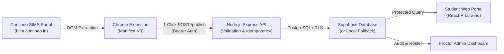

# Contineo Attendance Tracker
### Automated One-Click Attendance Extraction & Student Portal for BITM
**Ballari Institute of Technology & Management (BITM)**

---

## 🎯 Core Objective
**ONE CLICK BY THE PROCTOR → ALL STUDENTS' ATTENDANCE EXTRACTED → DATABASE UPDATED → STUDENTS CAN VIEW THEIR ATTENDANCE.**

In the BITM Contineo portal, subject-wise attendance percentages are visible to authorized proctors but are not directly accessible to students. This system bridges that gap completely with zero friction:

- **No manual entry of individual USNs.**
- **No opening individual student profiles.**
- **No downloading or converting PDFs.**
- **No file uploading or copy-pasting.**
- **One click synchronizes the entire cohort of students.**

---

## 🏗️ Architecture Overview



---

## 📁 Repository Structure

```
e:\conti-attnd\
├── extension/                  # Chrome Extension (Manifest V3)
│   ├── manifest.json           # Permissions, service worker, action popup
│   ├── content.js              # Multi-strategy DOM extraction engine
│   ├── service-worker.js       # Background event coordinator
│   ├── popup.html              # Academic dashboard popup UI
│   ├── popup.js                # One-click workflow state machine
│   ├── popup.css               # Styling
│   └── icons/                  # 16px, 32px, 48px, 128px PNG icons
│
├── backend/                    # Node.js API Service & Supabase
│   ├── src/
│   │   ├── server.js           # Express API, auth, routes, fixture host
│   │   └── db/
│   │       └── repository.js   # Dual-mode (Supabase Postgres + Local fallback)
│   ├── supabase/
│   │   ├── schema.sql          # Postgres DDL, indexes, unique constraints, RLS
│   │   └── seed.sql            # Seed subjects catalog
│   ├── package.json
│   └── .env.example
│
├── frontend/                   # Student & Proctor Web Application
│   ├── src/
│   │   ├── components/         # StudentDashboard, ProctorDashboard, ShortageCalculator, Navbar, LoginModal
│   │   ├── App.jsx             # Main routing and student selection
│   │   ├── main.jsx
│   │   └── index.css           # Tailwind styles
│   ├── index.html
│   ├── vite.config.js
│   ├── tailwind.config.js
│   └── package.json
│
├── test-fixtures/              # High-fidelity Contineo SIMS counselling test page
│   └── contineo-sims-fixture.html
│
├── tests/                      # Automated test suite
│   ├── parser.test.js          # DOM extraction tests on all 22 students
│   └── api.test.js             # API ingestion, idempotency & audit tests
│
└── docs/                       # Guides
    ├── EXTENSION_INSTALLATION.md
    ├── SUPABASE_SETUP.md
    ├── PROCTOR_ONE_CLICK_GUIDE.md
    └── STUDENT_PORTAL_GUIDE.md
```

---

## 🚀 Quick Start Guide

### 1. Install & Start the Backend
```bash
cd backend
npm install
npm start
```
The server starts on `http://localhost:5000`.
- Health Check: `http://localhost:5000/api/health`
- Contineo Test Fixture: `http://localhost:5000/fixture`

### 2. Start the Frontend Student Portal
```bash
cd frontend
npm install
npm run dev
```
Open `http://localhost:5173` to view the student portal.

### 3. Load the Chrome Extension
1. Open Google Chrome $\rightarrow$ `chrome://extensions/`.
2. Turn **Developer mode** **ON** (top right).
3. Click **Load unpacked** (top left).
4. Select the `extension/` directory.
5. Pin the extension to your toolbar.

---

## 🧪 Automated Test Verification

Run the test suite verifying DOM parsing across all 22 student sections, 220 subject entries, and database ingestion:

```bash
# Test 1: DOM Parser Verification
node tests/parser.test.js

# Test 2: Backend API & Idempotency Integration Test
node tests/api.test.js
```

**Results:**
- ✅ 22 out of 22 students detected.
- ✅ Student 1 (`3BR23CS001` - A Vedha Shree): 10 subjects extracted matching screenshot (Math: 91%, DS: 95%, Lab: 100%, Project: 60%).
- ✅ Student 2 (`3BR23CS002` - Manideep M): Exact match (Math: 95%, DS: 85%...).
- ✅ Zero duplicates on repeated proctor clicks (relational upsert).
- ✅ Import audit log verified.

---

## 🛡️ Security & Privacy Architecture
- **No Password Interception**: The extension never reads or stores passwords.
- **No Session Cookie Leakage**: Contineo session cookies and tokens are never transmitted to the backend.
- **Proctor Authorization**: Ingestion requires a secure Bearer token (`PROCTOR_SECRET_KEY`).
- **Postgres Row Level Security**: Students can only query their own records using their USN.
- **Fail-Safe Extraction**: Missing values or malformed percentages are flagged in error reports rather than quietly inventing data.

---

## 📚 Detailed Documentation Links
- [Chrome Extension Installation Guide](docs/EXTENSION_INSTALLATION.md)
- [Supabase Setup & Schema](docs/SUPABASE_SETUP.md)
- [Proctor One-Click Workflow](docs/PROCTOR_ONE_CLICK_GUIDE.md)
- [Student Dashboard Guide](docs/STUDENT_PORTAL_GUIDE.md)
